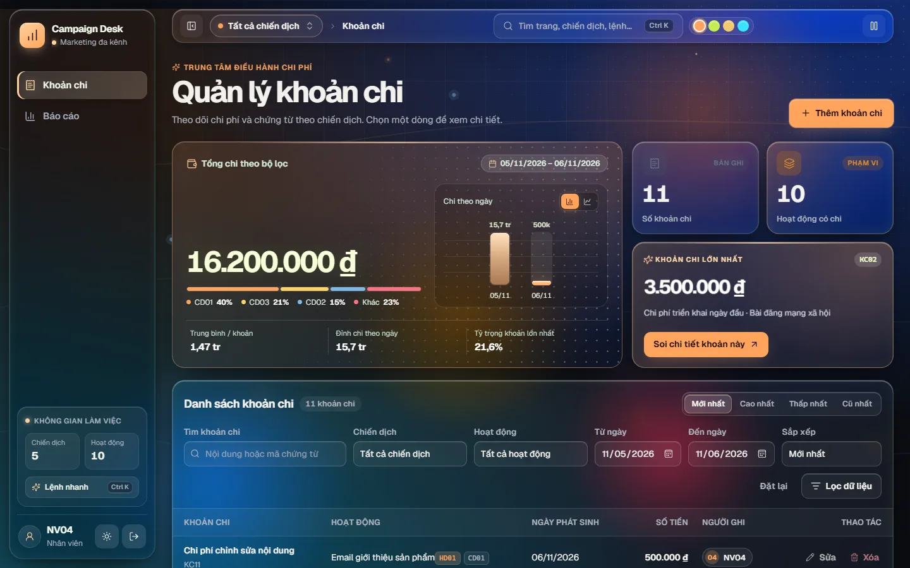
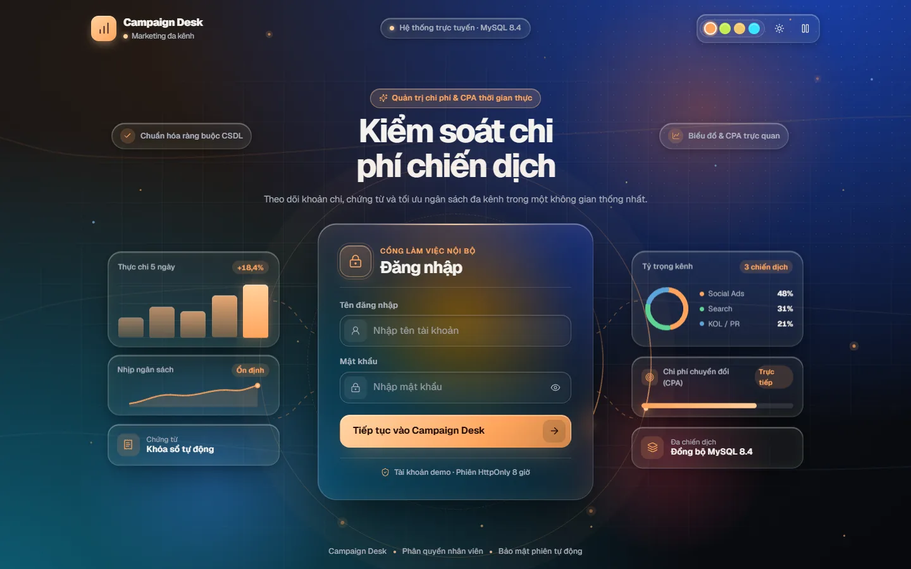
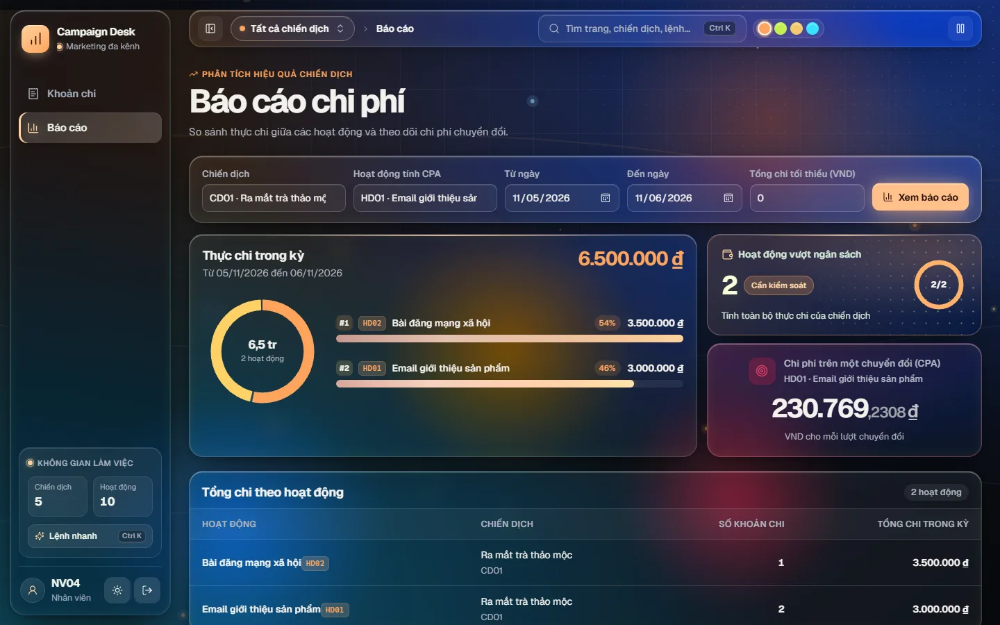
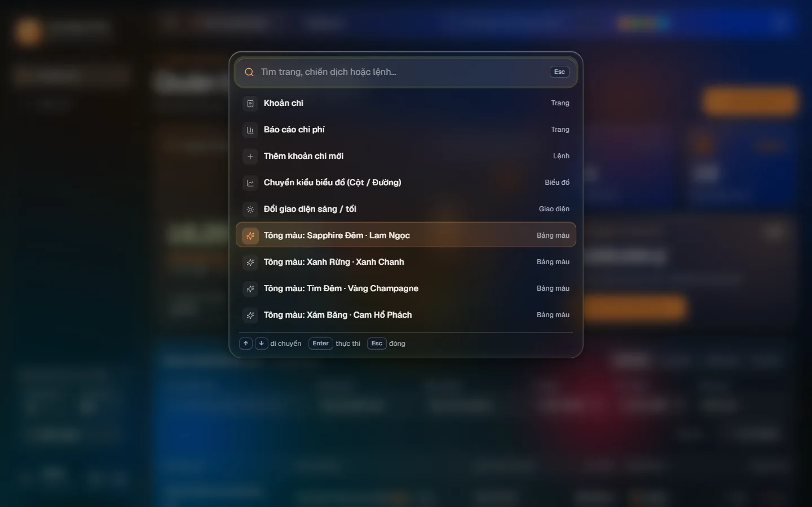
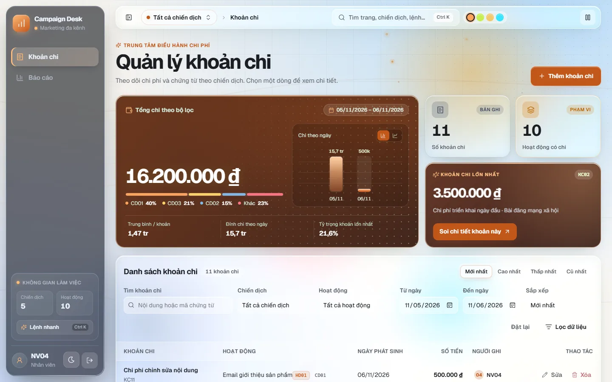
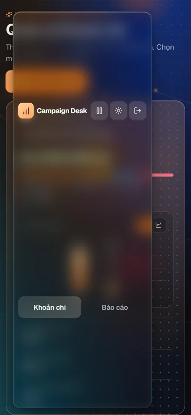
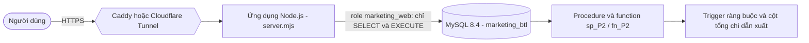
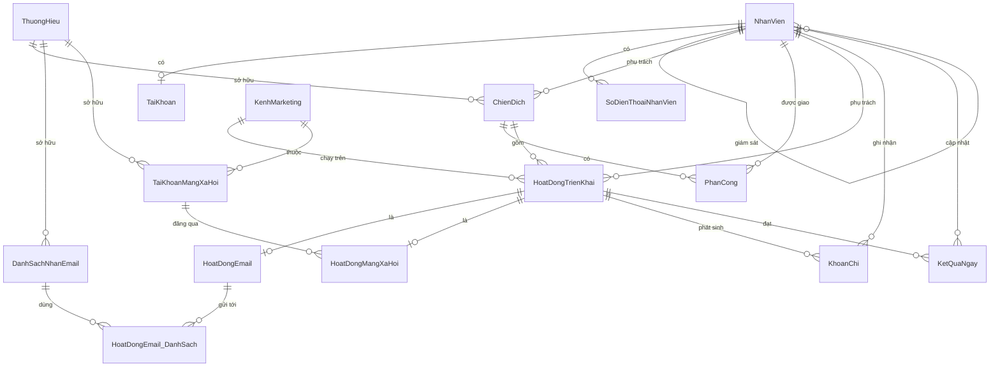

<div align="center">

# Campaign Desk

### Hệ cơ sở dữ liệu và web quản lý chi phí chiến dịch marketing đa kênh

Bài tập lớn 2 · MySQL 8.4 · Node.js · Docker

[](https://github.com/AIVIETNAM-AIO-LeWann/BTL2_marketing-campaign-db/actions/workflows/part1.yml)




</div>

---

## Mục lục

- [Tổng quan](#tổng-quan)
- [Hình ảnh](#hình-ảnh)
- [Kiến trúc](#kiến-trúc)
- [Tính năng](#tính-năng)
- [Bắt đầu nhanh](#bắt-đầu-nhanh)
- [Cấu trúc thư mục](#cấu-trúc-thư-mục)
- [Cơ sở dữ liệu](#cơ-sở-dữ-liệu)
- [Kiểm thử](#kiểm-thử)
- [Bảo mật](#bảo-mật)
- [Triển khai](#triển-khai)
- [Tài liệu](#tài-liệu)

## Tổng quan

Một chiến dịch marketing chạy trên nhiều kênh (email, mạng xã hội, quảng cáo…), mỗi kênh có nhiều hoạt động, và mỗi hoạt động phát sinh khoản chi cùng kết quả hằng ngày. Dự án này dựng toàn bộ vòng đời dữ liệu đó trên MySQL, ràng buộc chặt ngay trong cơ sở dữ liệu, rồi đặt một ứng dụng web lên trên để người dùng ghi nhận khoản chi và đọc báo cáo.

| Phần | Nội dung | Vị trí |
|---|---|---|
| **1. Cơ sở dữ liệu** | 15 bảng, ràng buộc liên bảng, quy trình tạo dữ liệu có quan hệ bắt buộc, dữ liệu mẫu, view báo cáo | [`database/`](database/) |
| **2. Logic trong CSDL** | 2.1 thêm/sửa/xóa khoản chi, 2.2 trigger nghiệp vụ và cột dẫn xuất, 2.3 truy vấn và báo cáo, 2.4 hàm đếm vượt ngân sách và tính CPA | [`database/part2/`](database/part2/) |
| **3. Ứng dụng web** | Campaign Desk: đăng nhập, quản lý khoản chi, báo cáo CPA, gọi thẳng các routine MySQL | [`app/`](app/) |
| **Triển khai** | Docker Compose (MySQL, app, HTTPS bằng Caddy hoặc Cloudflare Tunnel) | [`deploy/`](deploy/) |

Mọi quy tắc nghiệp vụ nằm ở lớp MySQL. Web chỉ gọi procedure/function bằng một tài khoản quyền tối thiểu, nên dù ai đó bỏ qua giao diện thì dữ liệu vẫn không thể sai.

## Hình ảnh

<table>
  <tr>
    <td width="50%"><br><sub><b>Đăng nhập</b> với phiên HttpOnly và giới hạn thử sai theo từng người</sub></td>
    <td width="50%"><br><sub><b>Báo cáo chi phí</b>: thực chi theo hoạt động, hoạt động vượt ngân sách và CPA</sub></td>
  </tr>
  <tr>
    <td width="50%"><br><sub><b>Chi tiết khoản chi</b>: tỷ trọng trong kỳ lọc, sao chép mã, sửa và xóa</sub></td>
    <td width="50%"><br><sub><b>Bảng lệnh</b> <kbd>Ctrl</kbd>+<kbd>K</kbd>: chuyển trang, lọc chiến dịch, tìm khoản chi</sub></td>
  </tr>
  <tr>
    <td width="50%"><br><sub><b>Giao diện sáng và tối</b>, nhớ lựa chọn của người dùng</sub></td>
    <td width="50%" align="center"><br><sub><b>Điện thoại</b>: bố cục thích ứng theo màn hình</sub></td>
  </tr>
</table>

## Kiến trúc



Sơ đồ quan hệ giữa 15 bảng:



## Tính năng

**Cơ sở dữ liệu**

- **Ràng buộc nhiều tầng:** PK, FK, UNIQUE, NOT NULL, CHECK, cùng hơn 90 trigger bảo vệ các quy tắc liên bảng mà khóa ngoại không diễn đạt được (chuyên biệt hóa toàn phần, phân công người chính bao phủ toàn chiến dịch, hoạt động và phân công nằm trong thời gian của chiến dịch…).
- **Quy trình tạo dữ liệu trong một giao dịch:** `sp_P1_TaoNhanVien`, `sp_P1_TaoChienDich`, `sp_P1_TaoHoatDong` tạo đủ các bản ghi phụ thuộc, kiểm tra bất biến trước khi commit và rollback khi lỗi.
- **Cột dẫn xuất `TongChiPhiThucTe`** luôn khớp tổng khoản chi nhờ trigger `AFTER INSERT/UPDATE/DELETE`, kể cả khi sửa chuyển khoản chi sang hoạt động khác.
- **Khoản chi có kiểm soát:** người ghi phải được phân công và có tài khoản hoạt động, không ghi vào hoạt động hoặc chiến dịch đã kết thúc (khóa sổ), và procedure kiểm tra lại quyền ở mọi lần ghi.
- **Báo cáo trong SQL:** tổng chi theo hoạt động có ngưỡng lọc, đếm hoạt động vượt ngân sách và CPA bằng function dùng con trỏ.

**Ứng dụng web**

- Quản lý khoản chi: thêm, sửa, xóa (có xác nhận), tìm kiếm, lọc theo chiến dịch/hoạt động/ngày, sắp xếp.
- Báo cáo: biểu đồ thực chi theo hoạt động, số hoạt động vượt ngân sách và CPA.
- Trải nghiệm: bảng lệnh <kbd>Ctrl</kbd>+<kbd>K</kbd>, khung chi tiết, chuyển chiến dịch một chạm, thu gọn thanh bên bằng <kbd>Ctrl</kbd>+<kbd>B</kbd>, giao diện sáng/tối, đủ trên điện thoại, thông báo lỗi tiếng Việt.
- Hỗ trợ truy cập: kiểm tra axe không có vi phạm, tôn trọng `prefers-reduced-motion` và `prefers-contrast`.

## Bắt đầu nhanh

> Yêu cầu: MySQL **8.4** (InnoDB, `utf8mb4`, không dùng MariaDB hay 5.7), `mysql` client, Node.js **22.9+**. Python 3 nếu chạy kiểm thử.

### Chạy web demo trên máy

```sh
git clone https://github.com/AIVIETNAM-AIO-LeWann/BTL2_marketing-campaign-db.git
cd BTL2_marketing-campaign-db

node scripts/setup-demo.mjs       # nạp CSDL mẫu, tạo role web và file app/.env
cd app && npm ci && npm start     # mở http://127.0.0.1:8080
```

Đăng nhập bằng tài khoản `demo` và mật khẩu `DEMO_PASSWORD` trong `app/.env`. Trang Khoản chi trên dữ liệu mẫu có **11 khoản chi**. Muốn chia sẻ qua internet, chạy `npm run tunnel` trong `app/` để có địa chỉ HTTPS tạm thời, xem [hướng dẫn Cloudflare](docs/demo-cloudflare.md).

### Chỉ dựng cơ sở dữ liệu

Chỉ chạy trên database trống. Script cố ý không có `CREATE TABLE IF NOT EXISTS` để không che giấu một lược đồ cũ và không dùng `--force` vì tùy chọn này có thể bỏ qua lỗi rồi nạp tiếp dữ liệu thiếu.

```console
mysql --default-character-set=utf8mb4 -h 127.0.0.1 -P 3306 -u root -p
```

```sql
-- Phần 1: lược đồ, ràng buộc, dữ liệu mẫu (mỗi bước phải thành công mới chạy bước kế)
SOURCE database/01_schema.sql;
SOURCE database/02_constraints.sql;
SOURCE database/03_creation_workflows.sql;
SOURCE database/04_seed.sql;
SOURCE database/05_reports.sql;
SOURCE database/06_verify.sql;

-- Phần 2: routine và trigger khoản chi (chỉ chạy một lần trên mỗi database)
SOURCE database/part2/01_expense_triggers.sql;
SOURCE database/part2/02_expense_crud.sql;
SOURCE database/part2/03_expense_queries.sql;
SOURCE database/part2/04_marketing_functions.sql;

-- Phần 3: role quyền tối thiểu cho web
SOURCE database/part3/01_app_role.sql;
```

Có Bash thì `bash scripts/bootstrap.sh -u root -p` chạy cả phần 1 trong một phiên. Không nạp lại seed phần 1 sau khi đã cài phần 2. Tài khoản thiết lập cần quyền tạo function và cấp EXECUTE; cấu hình binary logging có thể yêu cầu thêm quyền quản trị.

### Chạy liên tục 24/7 bằng Docker

```sh
cd deploy && cp .env.example .env     # điền mật khẩu
docker compose -f docker-compose.yml -f docker-compose.caddy.yml up -d --build
```

Lần đầu MySQL tự nạp toàn bộ SQL. Chi tiết từng bước, kể cả phương án Cloudflare Tunnel, ở [hướng dẫn triển khai](docs/deploy-docker.md).

## Cấu trúc thư mục

```text
database/
  01_schema.sql … 06_verify.sql      # phần 1: bảng, ràng buộc, workflow, seed, view, minh chứng
  part2/                             # 2.1 CRUD · 2.2 trigger · 2.3 truy vấn · 2.4 function
  part3/01_app_role.sql              # role marketing_web: quyền tối thiểu cho web
  tests/                             # kiểm thử tích hợp Python
app/                                 # web Node.js (server.mjs) và giao diện (public/)
deploy/                              # Docker Compose, Caddyfile, script nạp CSDL
scripts/                             # setup-demo.mjs, bootstrap.sh, mysql-docker.sh
docs/                                # tài liệu thiết kế, demo, triển khai
.github/workflows/                   # CI: dựng CSDL và chạy kiểm thử
```

## Cơ sở dữ liệu

<details>
<summary><b>Dữ liệu mẫu (15 bảng)</b></summary>

| Bảng | Số dòng | Bảng | Số dòng |
|---|---:|---|---:|
| NhanVien | 8 | HoatDongEmail | 5 |
| TaiKhoan | 8 | DanhSachNhanEmail | 6 |
| SoDienThoaiNhanVien | 9 | HoatDongEmail_DanhSach | 5 |
| ThuongHieu | 5 | TaiKhoanMangXaHoi | 6 |
| KenhMarketing | 5 | HoatDongMangXaHoi | 5 |
| ChienDich | 5 | KhoanChi | 11 |
| PhanCong | 10 | KetQuaNgay | 20 |
| HoatDongTrienKhai | 10 | | |

Tên người, thương hiệu, địa chỉ `.example` và tài khoản nền tảng là dữ liệu minh họa; chuỗi `MatKhauBam` là giá trị mẫu. Tiền tệ thống nhất VND, kiểu `DECIMAL(18,0)`. Dữ liệu cố ý có: hoạt động vượt ngân sách (được phép), chiến dịch hoàn thành hoặc hủy giữ lịch sử, tài khoản nhân viên bị khóa, số chuyển đổi bằng 0 hoặc chưa biết (`NULL`).

</details>

<details>
<summary><b>Tạo dữ liệu có quan hệ bắt buộc</b></summary>

MySQL/InnoDB không có deferred constraint để chờ đến `COMMIT` mới kiểm tra khóa ngoại. Vì vậy nhân viên–tài khoản, chiến dịch–phân công người chính và hoạt động–lớp con–danh sách phải tạo qua các workflow ở file 03:

- `sp_P1_TaoNhanVien(JSON nhan_vien, JSON tai_khoan)`
- `sp_P1_TaoChienDich(JSON chien_dich)`: tự thêm phân công người chính bao phủ toàn chiến dịch
- `sp_P1_TaoHoatDong(JSON hoat_dong, JSON chi_tiet, JSON mang_ma_danh_sach)`: nhóm kênh quyết định lớp con, email cần ít nhất một danh sách

Mỗi workflow giữ khóa ghi, tạo các dòng trong một giao dịch, kiểm tra toàn bộ bất biến trước khi commit và rollback nếu lỗi. Gọi ở cấp ngoài cùng, không bọc trong giao dịch khác. Đầu vào JSON được kiểm tra trường bắt buộc và kiểu dữ liệu; ngày phải hợp lệ, ngân sách là số nguyên VND. Xem lời gọi hoàn chỉnh trong file 04.

Biến phiên `@p1_internal` chỉ giúp trì hoãn kiểm tra toàn phần bên trong workflow, **không phải cơ chế phân quyền**. Role `marketing_p1` có SELECT, EXECUTE ba workflow và hai function 2.4, không có quyền ghi bảng. Role `marketing_web` của ứng dụng chỉ có các quyền cần thiết (xem [`01_app_role.sql`](database/part3/01_app_role.sql)). Không dùng root làm tài khoản ứng dụng.

</details>

<details>
<summary><b>Sửa dữ liệu thủ công để khảo sát</b></summary>

Dùng phiên quản trị riêng, đặt isolation `READ COMMITTED` **trước giao dịch**, không đặt `@p1_internal=1`. Trigger kiểm tra sau mỗi dòng thay đổi; một số thao tác nhiều bước phải dùng workflow để không đi qua trạng thái thiếu bản ghi bắt buộc.

```sql
SET SESSION TRANSACTION ISOLATION LEVEL READ COMMITTED;
START TRANSACTION;
UPDATE KhoanChi SET SoTien=2600000 WHERE MaKhoanChi='KC01';
CALL sp_P1_KiemTraToanVen();
ROLLBACK; -- minh họa, không giữ thay đổi
DO RELEASE_LOCK('marketing_btl.integrity');
```

Khóa tên `marketing_btl.integrity` được giữ đến hết workflow; phiên quản trị ghi trực tiếp giữ khóa đến khi tự giải phóng hoặc ngắt kết nối. Nếu câu lệnh lỗi, rollback rồi giải phóng khóa. Không chạy nhiều phiên ghi quản trị tùy tiện và không tắt khóa ngoại hay trigger.

</details>

## Kiểm thử

| Bộ kiểm thử | Phạm vi | Kết quả |
|---|---|---|
| [`test_constraints.py`](database/tests/test_constraints.py) | Ràng buộc phần 1, ca hợp lệ và cố ý vi phạm, quyền | 81 test |
| [`test_expense_integration.py`](database/tests/test_expense_integration.py) | Ghép CRUD, truy vấn và trigger 2.1–2.3 | 19 test |
| [`test_marketing_functions.py`](database/tests/test_marketing_functions.py) | Hai function 2.4 | 27 test |
| GitHub Actions `MySQL checks` | Dựng CSDL sạch, chạy cả ba bộ trên, kiểm tra role web | PR vào `main` và push lên `main`, `feat/**` |

Chạy trên database thử nghiệm đã nạp seed. Tài khoản kiểm thử là quản trị vì có ca kiểm tra quyền bằng một user tạm; user này được xóa ở cuối. Không ghi mật khẩu vào mã nguồn, dùng `MYSQL_PWD` hoặc option file của client.

```console
python database/tests/test_constraints.py --mysql mysql --host 127.0.0.1 --port 3306 --user root
python database/tests/test_expense_integration.py --mysql mysql --host 127.0.0.1 --port 3306 --user root
python database/tests/test_marketing_functions.py --mysql mysql --host 127.0.0.1 --port 3306 --user root
```

Lớp web được kiểm tra riêng bằng 72 ca API (xác thực, giới hạn đăng nhập, kiểm tra đầu vào, CRUD, quyền) và các kịch bản giao diện bằng Playwright (CRUD, biểu mẫu tiếng Việt, axe không có vi phạm). Chi tiết kết quả phần 1 ở [`docs/part1-test-results.md`](docs/part1-test-results.md).

## Bảo mật

- **Quyền tối thiểu:** web kết nối bằng role `marketing_web`, chỉ `SELECT` các bảng cần đọc và `EXECUTE` đúng các routine; mọi lần ghi đi qua procedure.
- **Phiên đăng nhập:** cookie `HttpOnly`, `SameSite=Lax`, thêm `Secure` khi chạy qua HTTPS, hết hạn sau 8 giờ.
- **Chống dò mật khẩu:** giới hạn thử sai theo từng địa chỉ người dùng và có trần chung; so sánh mật khẩu bằng thao tác thời gian hằng.
- **Chống tấn công trình duyệt:** `Content-Security-Policy` chặt, kiểm tra `Sec-Fetch-Site` cho yêu cầu ghi, thoát ký tự đại diện của `LIKE`.
- **Chống chiếm kết nối:** timeout đầu yêu cầu và thân yêu cầu ngắn, giới hạn kích thước dữ liệu.
- **Triển khai Docker:** cổng của app không mở ra ngoài, chỉ proxy tin cậy truy cập được; không commit `.env`.

## Triển khai

| Cách | Phù hợp | Hướng dẫn |
|---|---|---|
| Máy cá nhân + Cloudflare Quick Tunnel | Demo trong buổi bảo vệ, miễn phí | [`docs/demo-cloudflare.md`](docs/demo-cloudflare.md) |
| Docker Compose + Caddy + `sslip.io` | Chạy 24/7 trên máy chủ, địa chỉ cố định không cần tên miền | [`docs/deploy-docker.md`](docs/deploy-docker.md) |
| Docker Compose + Cloudflare Tunnel có tên | Chạy 24/7 với tên miền riêng | [`docs/deploy-docker.md`](docs/deploy-docker.md) |

## Tài liệu

| Tài liệu | Nội dung |
|---|---|
| [`docs/constraints.md`](docs/constraints.md) | Đối chiếu từng yêu cầu ràng buộc với cách hiện thực |
| [`docs/design-decisions.md`](docs/design-decisions.md) | Các quyết định thiết kế, thay đổi và giới hạn |
| [`docs/part1-test-results.md`](docs/part1-test-results.md) | Kết quả kiểm thử phần 1 |
| [`docs/part2-triggers.md`](docs/part2-triggers.md) | Ma trận DML và lệnh demo trigger 2.2 |
| [`docs/part2-functions.md`](docs/part2-functions.md) | Đặc tả, minh họa và đối chiếu function 2.4 |
| [`docs/part3-web.md`](docs/part3-web.md) | Chức năng web, thao tác nhanh, kịch bản trình bày, chỗ cần sửa khi bàn giao |
| [`docs/demo-cloudflare.md`](docs/demo-cloudflare.md) | Demo qua Cloudflare Tunnel |
| [`docs/deploy-docker.md`](docs/deploy-docker.md) | Triển khai 24/7 bằng Docker |

---

<div align="center">
<sub>Font <a href="app/LICENSE-Geist.txt">Geist</a> và bộ icon <a href="app/LICENSE-Lucide.txt">Lucide</a> được lưu cục bộ theo giấy phép đi kèm.</sub>
</div>
